<style>
.cols { display: flex; gap: 1.2em; align-items: flex-start; }
.cols > div { flex: 1; }
.svgbox { text-align: center; margin-top: .2em; }
.svgbox img { max-width: 100%; max-height: 420px; height: auto; }
.cap { font-size: .72em; color: #8c8c8c; text-align:center; margin-top:.1em; }
svg text { font-family: inherit; }
</style>

<!-- _class: cover_e -->
<!-- _header:   -->
<!-- _footer:  -->
<!-- _paginate: "" -->

# Chapter 3: Unsupervised Learning & Preprocessing 
###### <br>Scaling, dimensionality reduction, and clustering

Introduction to Machine Learning
Zhang Li, Jing Ming
Fall 2026

---

## Learning Objectives

- Understand what **unsupervised learning** is and why it's **hard to evaluate**
- Scale features correctly — and avoid the classic **data-leakage** bug
- Reduce dimensions & extract features with **PCA, NMF, t-SNE**
- Group data with **k-Means, agglomerative clustering, DBSCAN**
- Evaluate clusters **with and without** ground truth

> Unlike Chapter 2, there is **no target `y`** — we learn from `X` alone.

---

## 3.1 · Types of Unsupervised Learning

No known output, no teacher — just find **structure** in the input data.

<div class="svgbox">

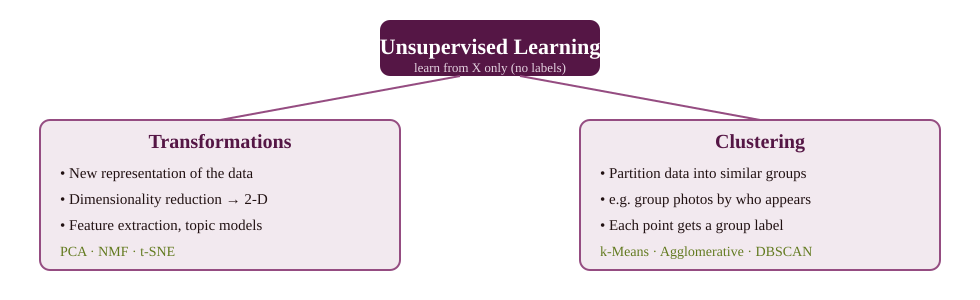

</div>

---


## 3.2 · The Central Challenge: Evaluation

<!-- _class: cols-2 --> 

<div class=ldiv>

- Usually **no labels** → no "right answer" to check against
- Hard to tell whether the model **learned something useful**
- Grouping photos might split by **pose** instead of **person** — and we can't correct it

**So it's mostly used for:**
- **Exploration** — to understand data
- **Preprocessing** that helps a supervised model

> Scaling uses no labels either → it counts as unsupervised.

</div>
<div class=rdiv>
<div class="svgbox">

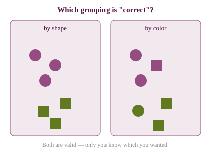

</div>
</div>

---

<!-- _class: trans -->
<!-- _footer: "" -->
<!-- _paginate: "" -->

## Part 1: <br> Preprocessing & Scaling

---

## 3.3.1 · Why Scale?

Some models — **SVMs, neural networks, k-NN** — are very sensitive to feature scales.
A feature ranging 0–1000 shouldn't dominate one ranging 0–1.

<div class="svgbox">

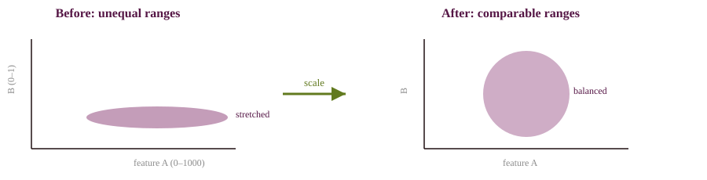

</div>

The fix: a per-feature **shift and rescale** — a simple `fit` → `transform`.

---

## 3.3.1 · Four Common Scalers

<div class="cols">
<div>

| Scaler | What it does |
|--------|--------------|
| **StandardScaler** | mean 0, variance 1 |
| **RobustScaler** | median & quartiles → ignores outliers |
| **MinMaxScaler** | shifts data into exactly **[0, 1]** |
| **Normalizer** | each *sample* to unit length (direction) |

Same interface — swap one for another by changing the class name.

</div>
<div>
<div class="svgbox">

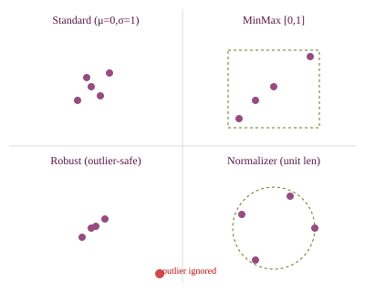

</div>
</div>
</div>

---

## 3.3.2 · Applying a Scaler

```python
from sklearn.preprocessing import MinMaxScaler
scaler = MinMaxScaler()
scaler.fit(X_train)                    # learns per-feature min & range
X_train_scaled = scaler.transform(X_train)
X_test_scaled  = scaler.transform(X_test)
```

<div class="svgbox">

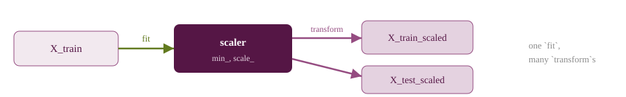

</div>

Unlike classifiers, `fit` uses **only `X_train`** — no `y`. `transform` keeps the shape.

---

## 3.3.3 · Scale Train & Test the *Same* Way

⚠️ Fit the scaler on **training data only**, then apply that *same* transform to test.

<div class="cols">
<div>
<div class="svgbox">

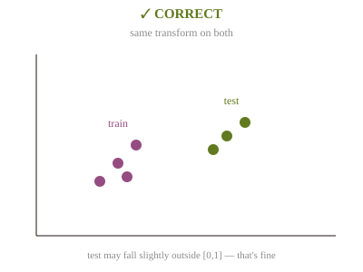

</div>
</div>
<div>
<div class="svgbox">

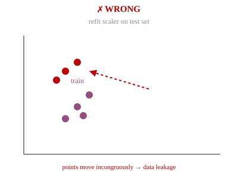

</div>
</div>
</div>

```python
# WRONG — refitting on the test set moves the points incongruously
test_scaler = MinMaxScaler().fit(X_test)   # DON'T DO THIS
```

---

## Shortcut: `fit_transform`

For fitting and transforming the **same** data, use one efficient call:

```python
from sklearn.preprocessing import StandardScaler
scaler = StandardScaler()
X_scaled = scaler.fit_transform(X_train)   # = fit(X).transform(X), faster
```

Use it on the **training set only** — never on the test set.

---

## 3.3.4 · Effect on Supervised Learning

Scaling can transform results — **same SVM, same data**:

<div class="cols">
<div>

```python
svm = SVC(C=100)
svm.fit(X_train, y_train)         # unscaled
svm.score(X_test, y_test)         # 0.63

svm.fit(X_train_scaled, y_train)  # MinMax
svm.score(X_test_scaled, y_test)  # 0.97
```

**Use scikit-learn's scalers** rather than reimplementing — easy to slip up.

</div>
<div>
<div class="svgbox">

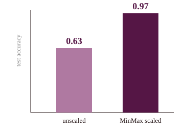

</div>
</div>
</div>

---

<!-- _class: trans -->
<!-- _footer: "" -->
<!-- _paginate: "" -->

## Part 2: <br> Dimensionality Reduction & Feature Extraction

---

## Scikit-learn datasets for cancer

Scikit-learn includes two small, ready-to-use datasets for cancer-related classification. They’re useful for learning and prototyping; they are not a substitute for clinical data or medical validation.

| Dataset | What it contains | Typical use | Access |
|---|---|---|---|
| **Breast Cancer Wisconsin (Diagnostic)** | 569 cases; 30 numeric features computed from digitized breast-mass images; labels are **benign** or **malignant** | Binary classification and model evaluation | `sklearn.datasets.load_breast_cancer()` |
| **Breast Cancer Wisconsin (Original)** | 699 cases; 9 numeric cytological features; labels are **benign** or **malignant** | Introductory classification; includes missing values to handle | `sklearn.datasets.fetch_openml("breast-w", version=1)` |

**Takeaway:** Start with `load_breast_cancer()` for a simple, self-contained example. 

---

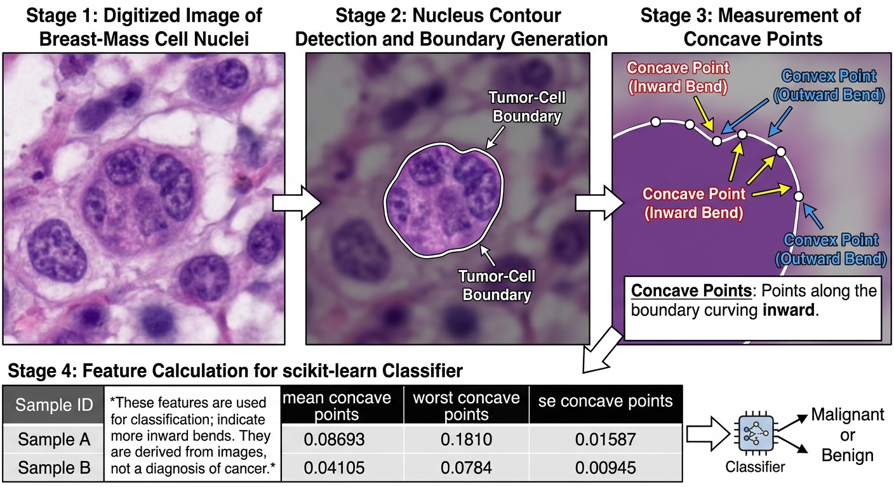

---

## Look at Your Data First

Before any model, inspect raw features. For **cancer**, plot per-feature histograms split by class.

<div class="cols">
<div>

- *"worst concave points"* → histograms **barely overlap** → very **informative**
- *"smoothness error"* → histograms **overlap** → uninformative
- A histogram shows **one feature at a time** — it misses **interactions**

> PCA captures interactions, giving a fuller picture in one scatter.

</div>
<div>
<div class="svgbox">

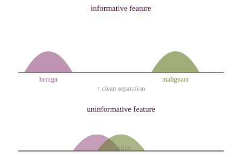

</div>
</div>
</div>

---

## 3.4.1 · Principal Component Analysis (PCA)

**Rotates** the data so new axes (principal components) are **uncorrelated**, ordered by the **variance** they capture.

<div class="cols">
<div>

- **PC1** = direction of **maximum variance**
- Each next PC is **orthogonal** to the previous
- Keep top *k* → **compress** while preserving structure

```python
from sklearn.decomposition import PCA
pca = PCA(n_components=2).fit(X_scaled)
X_pca = pca.transform(X_scaled)
```

⚠️ **Scale first** (StandardScaler) — PCA follows variance.

</div>
<div>
<div class="svgbox">

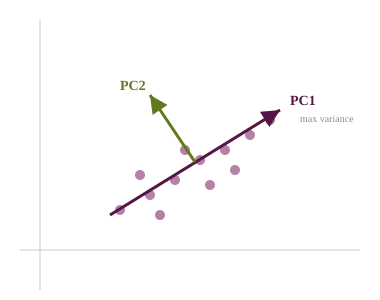

</div>
</div>
</div>

---

## PCA for Visualization

Plot high-dimensional data in 2-D. Cancer: **30 features → 2 components**.

<div class="cols">
<div>

```python
X_pca = PCA(n_components=2).fit_transform(X_scaled)
# (569, 30)  →  (569, 2)
```

- The two classes **separate well** in 2-D → even a linear model could do well
- PCA is **unsupervised** — it never sees labels; we only **color** by class *after*

</div>
<div>
<div class="svgbox">

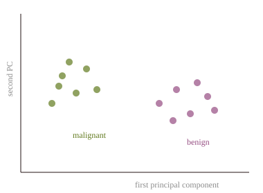

</div>
</div>
</div>

---

## Interpreting the Components

```python
pca.components_          # shape (2, 30): each row is one component
```

- Each component is a **combination of all original features**
- On cancer: the first component has **all-positive** signs → features are correlated
- ⚠️ Components are usually **hard to interpret** — the axes mix many features

---

## Feature Extraction: Eigenfaces

Apply PCA to **Labeled Faces in the Wild** (3023 images, 87×65 px, 62 people).

<div class="cols">
<div>

- Raw pixels are a **poor** similarity measure — shift by one pixel → "looks" totally different
- 1-NN on raw pixels: only **~27%** accuracy
- PCA with **whitening**, 100 components → 1-NN improves to **~36%**

```python
pca = PCA(n_components=100, whiten=True).fit(X_train)
X_train_pca = pca.transform(X_train)
```

</div>
<div>
<div class="svgbox">

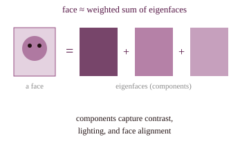

</div>
</div>
</div>

---

## PCA as Reconstruction

PCA can rebuild data from a few components via **`inverse_transform`**.

<div class="cols">
<div>

```python
X_rec = pca.inverse_transform(
            pca.transform(X_test))
```

- **10 components** → only the essence (orientation, lighting)
- **More components** → progressively more detail returns
- As many components as pixels → perfect reconstruction

Useful for **noise reduction** and compression.

</div>
<div>
<div class="svgbox">

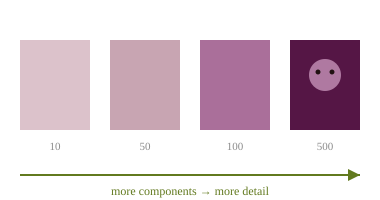

</div>
</div>
</div>

---

## 3.4.2 · Non-Negative Matrix Factorization (NMF)

Like PCA, each point = a **weighted sum of components** — but components **and** coefficients must be **non-negative**.

<div class="cols">
<div>

- Yields **additive, parts-based**, more interpretable components
- Only works on **non-negative data**
- Components have **no natural ordering**; **random init** → results vary by seed

```python
from sklearn.decomposition import NMF
nmf = NMF(n_components=15,
          random_state=0).fit(X)
```

</div>
<div>
<div class="svgbox">

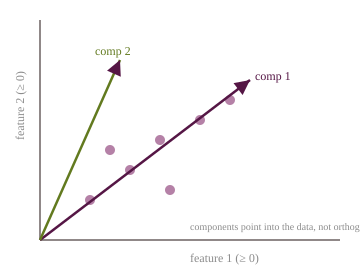

</div>
</div>
</div>

---

## NMF: Finding Additive Sources

NMF shines on data that is a **sum of sources** — audio, gene expression, text.

<div class="cols">
<div>

**Signal separation:** 3 original signals mixed into 100 measurements.

```python
S = NMF(n_components=3).fit_transform(X)
# recovers the 3 sources
```

- NMF recovers the sources well; **PCA fails** (it wants orthogonal, high-variance directions)
- On faces, NMF components look like **face prototypes** (turned left / right)

</div>
<div>
<div class="svgbox">

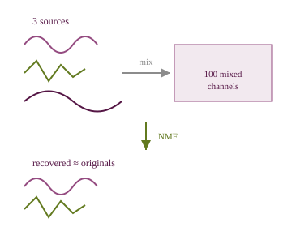

</div>
</div>
</div>

---

## Other Decomposition Methods

PCA and NMF both write each point as a **weighted sum of components**. scikit-learn offers more, each with different constraints:

- **ICA** (Independent Component Analysis) — statistically **independent** sources
- **Factor Analysis (FA)** — latent factors plus per-feature noise
- **Sparse coding** (dictionary learning) — few **active** components per point

See the user guide's *decomposition methods* page. The choice depends on the structure you expect in the data.

---

## 3.4.3 · Manifold Learning with t-SNE

A **nonlinear** method built **for visualization** (usually to 2-D).

<div class="cols">
<div>

- Keeps **nearby points close**, emphasizing neighbor relationships
- Finds structure PCA's rotate-and-drop approach misses

⚠️ **No `transform`** — can't be applied to new data. Use **`fit_transform`** only.

```python
from sklearn.manifold import TSNE
X_tsne = TSNE(random_state=42).fit_transform(X)
```

</div>
<div>
<div class="svgbox">

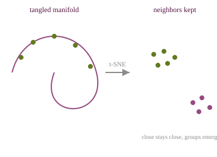

</div>
</div>
</div>

---

## t-SNE on the Digits Dataset

Handwritten digits (8×8 grayscale):

- **PCA** to 2-D → classes overlap heavily (only 0, 4, 6 separate)
- **t-SNE** → nearly all ten digit classes form **clear, separate groups**
- Remarkable given it uses **no label information** at all

Tuning knobs `perplexity` and `early_exaggeration` usually have minor effects.

---

<!-- _class: trans -->
<!-- _footer: "" -->
<!-- _paginate: "" -->

## Part 3: <br> Clustering

---

## 3.5.1 · k-Means Clustering

Find *k* **cluster centers**, alternating two steps until assignments stop changing:

<div class="cols">
<div>

1. **Assign** each point to its nearest center
2. **Recompute** each center as the mean of its points

```python
from sklearn.cluster import KMeans
km = KMeans(n_clusters=3).fit(X)
km.labels_            # cluster index per point
km.cluster_centers_   # the centroids
km.predict(X_new)     # assign new points
```

Must choose `n_clusters` (default 8, no good reason).

</div>
<div>
<div class="svgbox">

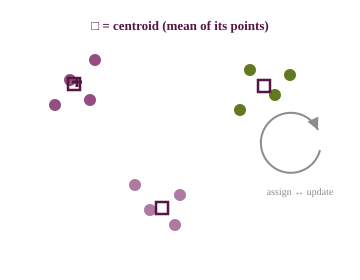

</div>
</div>
</div>

---

## Failure Cases of k-Means

k-Means assumes clusters are **convex, equal-sized blobs** — it always splits **halfway** between centers.

<div class="cols">
<div>

It struggles with:

- Clusters of **different densities**
- **Non-spherical** / stretched clusters
- Complex shapes like **two_moons**

> Knowing the right number of clusters doesn't guarantee k-Means will find them.

</div>
<div>
<div class="svgbox">

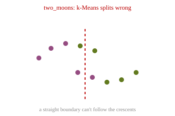

</div>
</div>
</div>

---

## k-Means as Vector Quantization

Each point is represented by its **single** cluster center — a decomposition view called *vector quantization*.

- Can use **more clusters than features** → a richer representation
- On two_moons, **10 centers** give features that make the halves **linearly separable**
- `kmeans.transform(X)` → distances to every center as new features

Scales well; **`MiniBatchKMeans`** handles very large datasets.

---

## Three Views: PCA, NMF, k-Means

All three express points via components — with different rules:

| Method | Each point = | Components point toward |
|--------|-------------|-------------------------|
| **PCA** | sum of orthogonal components | directions of max variance |
| **NMF** | non-negative sum | additive "parts" of the data |
| **k-Means** | one cluster center | representative regions |

k-Means is the extreme case: **a single component** per point (vector quantization).

---

## k-Means: Strengths & Weaknesses

✔ Simple, fast, **scales** to large datasets; easy to understand
✔ Cluster centers **summarize** each group

✘ Relies on **random initialization** (scikit-learn runs it 10× and keeps the best)
✘ Restrictive assumptions on cluster **shape**
✘ Must **specify the number of clusters**

---

## 3.5.2 · Agglomerative Clustering

**Bottom-up:** start with each point as its own cluster, repeatedly **merge the two closest** until *k* remain.

<div class="cols">
<div>

**Linkage** = how "closest" is measured:

| Linkage | Merges clusters with… |
|---------|----------------------|
| **ward** (default) | least increase in variance |
| **average** | smallest average distance |
| **complete** | smallest maximum distance |

```python
from sklearn.cluster import AgglomerativeClustering
AgglomerativeClustering(n_clusters=3).fit_predict(X)
```

</div>
<div>
<div class="svgbox">

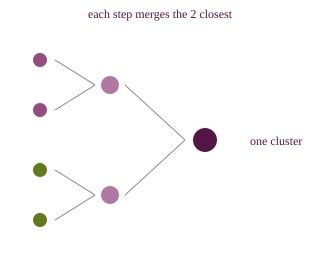

</div>
</div>
</div>

---

## Dendrograms

Agglomerative clustering builds a **hierarchy** — visualize it as a **dendrogram**.

<div class="cols">
<div>

- Each **merge** = a horizontal join; branch **length** = distance bridged
- **Cut** the tree at any height to choose the number of clusters
- scikit-learn can't draw them — use **SciPy**

```python
from scipy.cluster.hierarchy import dendrogram, ward
dendrogram(ward(X))
```

Still can't separate complex shapes like two_moons.

</div>
<div>
<div class="svgbox">

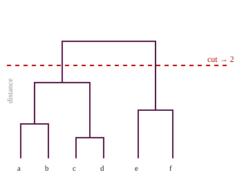

</div>
</div>
</div>

---

## 3.5.3 · DBSCAN

**Density-based** clustering: clusters are **dense regions** separated by sparse ones.

<div class="cols">
<div>

Three kinds of points (params **`eps`**, **`min_samples`**):

- **Core** — ≥ `min_samples` neighbors within `eps`
- **Boundary** — near a core point, not dense itself
- **Noise** — everything else, labeled **`-1`**

```python
from sklearn.cluster import DBSCAN
DBSCAN(eps=0.5, min_samples=5).fit_predict(X)
```

</div>
<div>
<div class="svgbox">

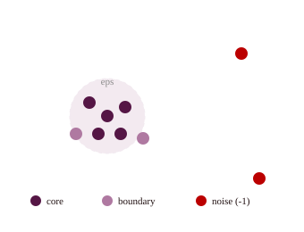

</div>
</div>
</div>

---

## Tuning & Using DBSCAN

- **`eps`** — how close is "close": larger → bigger, fewer clusters
- **`min_samples`** — minimum cluster size; larger → more points become **noise**
- **Does not need the number of clusters** set in advance
- **Scaling** (StandardScaler / MinMaxScaler) makes `eps` easier to choose

✔ Finds **arbitrary shapes** (splits two_moons with defaults) and flags **outliers**
✘ Slower than k-Means; boundary points can depend on point order

---

<!-- _class: trans -->
<!-- _footer: "" -->
<!-- _paginate: "" -->

## Part 4: <br> Evaluating Clustering

---

## 3.5.4 · Evaluating with Ground Truth

If you *do* have true labels, compare partitions with:

- **Adjusted Rand Index (ARI)** and **Normalized Mutual Information (NMI)** — both in **[0, 1]**
- Random assignment → **0**; perfect match → **1**

```python
from sklearn.metrics.cluster import adjusted_rand_score
adjusted_rand_score(y_true, clusters)
```

<div class="svgbox">

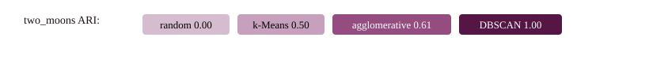

</div>

---

## Don't Use `accuracy_score`!

Cluster label **numbers are arbitrary** — the same grouping can use different integers.

```python
clusters1 = [0, 0, 1, 1, 0]
clusters2 = [1, 1, 0, 0, 1]     # identical grouping, swapped names
accuracy_score(clusters1, clusters2)      # 0.00  ✗ misleading
adjusted_rand_score(clusters1, clusters2) # 1.00  ✓ correct
```

Always use **ARI / NMI**, which only care about *which points share a cluster*.

---

## Evaluating without Ground Truth

Usually there are **no labels** — that's the whole point.

- **Silhouette score** — measures cluster **compactness** (higher = tighter)
- But compact ≠ meaningful: on two_moons, k-Means **scores higher** than the "better" DBSCAN result
- **Robustness-based** checks (perturb data, compare results) are more reliable

> In the end, the only sure test is **manual inspection** of the clusters.

---

## Case Study: Clustering Faces

Applying all three to the eigenface representation of LFW is a **qualitative** process:

- **DBSCAN** (defaults) → labels *everything* noise; raising `eps` yields one big cluster plus a few small ones — the "noise" images are **odd crops / angles** → **outlier detection**
- **k-Means** & **agglomerative** → many **similarly-sized** clusters (they must assign every point)
- ARI between k-Means and agglomerative ≈ **0.13** → they partition quite differently

> There's no accuracy score here — you judge clusters by **looking** at their members.

---

## 3.5.5 · Summary of Clustering Methods

| Method | Set clusters? | Cluster shapes | Extras |
|--------|:---:|---|---|
| **k-Means** | yes (`k`) | convex blobs | cluster centers; vector quantization |
| **Agglomerative** | yes (`k`) | varied | full hierarchy → dendrograms |
| **DBSCAN** | no (`eps`) | **arbitrary** | detects **noise / outliers** |

All three scale to real data and are easy to understand.

---

## 3.6 · Chapter Summary

- Unsupervised learning finds structure with **no labels** — and is **hard to evaluate**
- **Always scale** — and fit the scaler on **training data only** (avoid leakage)
- **PCA / NMF / t-SNE** compress, extract features, or visualize high-dim data
- **k-Means / agglomerative / DBSCAN** suit different cluster shapes & needs
- Evaluate with **ARI / NMI** (never accuracy); otherwise rely on **inspection**

**Next:** Chapter 4 — Representing Data & Engineering Features
