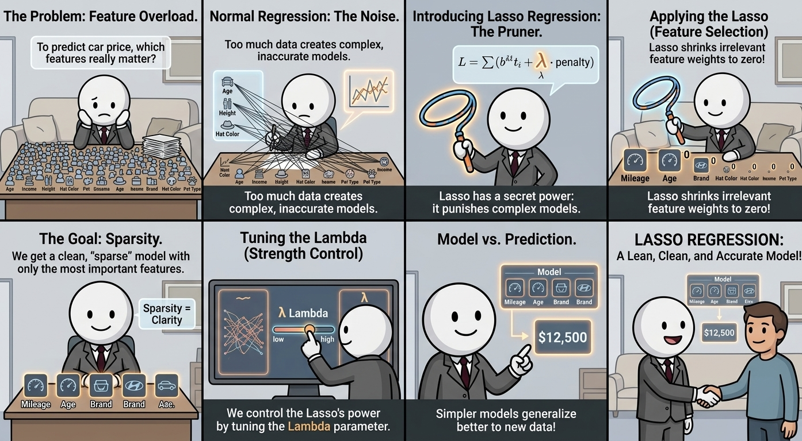

<!-- _footer: "" -->
<!-- _paginate: "" -->



---

<!-- _class: cover_e -->
<!-- _header:   --> 
<!-- _footer:  --> 
<!-- _paginate: "" -->

# Lasso Regression

#### Linear Models with L1 Regularization

Introduction to Machine Learning
Zhang Li, Jing Ming
Fall 2026

---

<!-- _header: Learning objectives -->
<!-- _class: toc_b -->
<!-- _footer: "" -->
<!-- _paginate: "" -->

* Understand the Lasso objective function.
* Explain L1 regularization.
* Understand why Lasso performs feature selection.
* Explore the geometric interpretation.
* Implement Lasso in Python.

---

### What Is Linear Regression?

Linear regression predicts a continuous target using a weighted combination of input features.

For one feature: $\hat y = \beta_0+\beta_1x$

For multiple features:

$$
\hat y=\beta_0+\sum_{j=1}^{p}\beta_jx_j
$$

Where:

* $y$: observed target.
* $\hat y$: predicted target.
* $x_j$: input feature.
* $\beta_j$: coefficient of feature $j$.
* $\beta_0$: intercept.

The coefficients describe how the model uses each feature to make predictions.

---

### How Does Ordinary Linear Regression Learn?

Suppose we have $n$ training observations and $p$ features.

For observation $i$:

$$
\hat y_i=\beta_0+\sum_{j=1}^{p}\beta_jx_{ij}
$$

The residual is:

$$
e_i=y_i-\hat y_i
$$

Ordinary Least Squares minimizes the sum of squared residuals:

$$
\boxed{
\min_{\beta_0,\boldsymbol\beta}
\sum_{i=1}^{n}(y_i-\hat y_i)^2
}
$$

This objective focuses entirely on fitting the training data.

Problem: When there are many features, the resulting model may become unnecessarily complex.

---

### Why Do We Need Regularization?

A model may fit training data well but perform poorly on new observations.

This is called overfitting.

Potential causes include:

* Too many features.
* Noisy measurements.
* Strongly correlated predictors.
* Too few observations relative to the number of features.

Regularization adds a penalty to discourage undesirable model complexity.

Two important regularized linear models are:

* Ridge Regression: L2 penalty.
* Lasso Regression: L1 penalty.

Both control coefficient magnitudes, but they behave differently.

---

### The Main Idea of Lasso Regression

Lasso stands for Least Absolute Shrinkage and Selection Operator.

It modifies linear regression by penalizing the absolute values of the coefficients.

The objective is:

$$
\boxed{
\min_{\beta_0,\boldsymbol\beta}
\left[
\sum_{i=1}^{n}(y_i-\hat y_i)^2
+
\lambda\sum_{j=1}^{p}|\beta_j|
\right]
}
$$

The first term measures prediction error.

The second term penalizes large coefficients.

This penalty is called L1 regularization.

The intercept is typically not penalized.

---

### What Does the L1 Penalty Mean?

The L1 penalty is:

$$
|\boldsymbol\beta|_1

\sum_{j=1}^{p}|\beta_j|
$$

For example, suppose:

$$
\boldsymbol\beta=
\begin{bmatrix}
3\
-2\
0.5
\end{bmatrix}
$$

Then:

$$
|\boldsymbol\beta|_1

|3|+|-2|+|0.5|
=5.5
$$

Lasso penalizes the total absolute magnitude of the coefficients.

Unlike the squared L2 penalty, the L1 penalty has a sharp corner at zero.

That geometric property helps explain why Lasso can produce coefficients that are exactly zero.

---

### Understanding Lambda

The regularization parameter $\lambda$ controls the strength of the penalty.

$$
J(\boldsymbol\beta)

\underbrace{\sum_{i=1}^{n}(y_i-\hat y_i)^2}{\text{Data fit}}
+
\underbrace{\lambda\sum{j=1}^{p}|\beta_j|}_{\text{L1 penalty}}
$$

|Lambda | Typical effect|
|---|---|
$\lambda=0$|Ordinary least squares objective
Small $\lambda$ |Mild shrinkage
Moderate $\lambda$ | More coefficients may become zero
Large $\lambda$ | Stronger shrinkage and a simpler model

As $\lambda$ increases, Lasso generally retains fewer nonzero coefficients.

For sufficiently strong regularization, all feature coefficients can become zero.

The intercept can still remain nonzero.

---

### Why Can Lasso Set Coefficients to Zero?

Consider a simplified problem with one coefficient:

$$
\min_{\beta}
\left[
\frac{1}{2}(z-\beta)^2+\lambda|\beta|
\right]
$$

Its solution is the soft-thresholding rule:

$$
\boxed{
\hat\beta=
\operatorname{sign}(z)
\max(|z|-\lambda,0)
}
$$

Interpretation:

* If $|z|\leq\lambda$, the coefficient becomes zero.
* If $z>\lambda$, the coefficient shrinks toward zero.
* If $z<-\lambda$, the coefficient also shrinks toward zero.

---

For example, let $z=0.7$.

If $\lambda=0.2$:

$$
\hat\beta=0.7-0.2=0.5
$$

If $\lambda=0.8$:

$$
\hat\beta=0
$$

This is the key intuition behind Lasso’s feature-selection behavior.

The formula applies directly to this simplified one-dimensional objective, or to individual coefficients under suitable orthogonal-design conditions.

---

### Visualizing Lasso Coefficient Shrinkage

As regularization increases:

* Some coefficients gradually shrink.
* Some coefficients reach exactly zero.
* The model becomes sparse.

A sparse model uses only a subset of the available features.

This behavior can improve interpretability when many candidate predictors are available.

However, a zero coefficient does not prove that the corresponding variable is scientifically or causally irrelevant.

---

### Geometric Interpretation

Consider two coefficients:

$$
\boldsymbol\beta=
\begin{bmatrix}
\beta_1\
\beta_2
\end{bmatrix}
$$

The L1 penalty defines diamond-shaped contours:

$$
|\beta_1|+|\beta_2|\leq t
$$

The least-squares objective has elliptical contours.

Lasso minimizes prediction error subject to an L1 constraint.

The solution occurs where a loss contour first touches the L1 constraint region.

Because the diamond has corners on the coordinate axes, the solution often lies on an axis.

That means at least one coefficient is exactly zero.

---

<!--_footer: "" -->

### Lasso vs. Ridge Regression

| Property | Ridge Regression | Lasso Regression|
|---|---|---|
Penalty | L2 | L1
Penalty expression | $\sum_j\beta_j^2$ | $\sum_j
Shrinks coefficients | Yes | Yes
Sets coefficients exactly to zero | Generally no | Yes
Feature selection | No built-in sparsity | Yes
Correlated predictors | Often distributes weights | May select one or a subset
Typical result | Dense coefficient vector | Potentially sparse coefficient vector


Rule of thumb:

* Choose Ridge when coefficient stability across many features is important.
* Consider Lasso when a simpler model with fewer active features is desirable.

Neither model is universally better.

---

### What Happens with Correlated Features?

Suppose two predictors carry almost identical information.

Lasso may select one predictor and set the other coefficient to zero.

This can simplify the model.

However, when features are highly correlated:

* The selected feature can change across training samples.
* Different correlated predictors may be selected in different folds.
* The selected variable may not be uniquely identifiable.

If retaining groups of correlated features is important, Elastic Net may be worth considering.

Elastic Net combines L1 and L2 regularization.

---

<!-- _footer: "" -->

### Choosing Lambda with Cross-Validation

The regularization parameter should be selected using training data, typically through cross-validation.

A candidate grid might be:

$$
\lambda\in
{10^{-4},10^{-3},10^{-2},\ldots,10^2}
$$

Procedure:

1. Split the available data into training and test sets.
2. Standardize features within each training fold.
3. Fit Lasso with different regularization strengths.
4. Compare validation errors.
5. Select the preferred value.
6. Refit the model using the training data.
7. Evaluate once on the held-out test set.

A scikit-learn pipeline helps prevent information leakage during preprocessing.

The best lambda depends on the dataset, target scale, feature scaling, and loss-function convention.

---

### Lasso Regression in Python

Scikit-learn provides LassoCV for selecting the regularization parameter by cross-validation.

---

```python
import numpy as np
from sklearn.pipeline import make_pipeline
from sklearn.preprocessing import StandardScaler
from sklearn.linear_model import LassoCV
from sklearn.model_selection import train_test_split
from sklearn.metrics import mean_squared_error, r2_score
X_train, X_test, y_train, y_test = train_test_split(
    X, y,
    test_size=0.2,
    random_state=42
)
model = make_pipeline(
    StandardScaler(),
    LassoCV(
        alphas=np.logspace(-4, 1, 100),
        cv=5,
        max_iter=50000
    )
)
model.fit(X_train, y_train)
lasso = model.named_steps["lassocv"]
y_pred = model.predict(X_test)
print("Best alpha:", lasso.alpha_)
print("Test MSE:", mean_squared_error(y_test, y_pred))
print("Test R²:", r2_score(y_test, y_pred))
print("Coefficients:", lasso.coef_)
print("Selected features:", np.sum(lasso.coef_ != 0))
```

---

Here, X is the feature matrix and y is the continuous target.

StandardScaler is particularly important when features have different units or scales.

---

### Important Practical Considerations

1. Scale the features

Lasso penalizes coefficient magnitudes. Features with different scales can receive unequal effective treatment if they are not standardized.

2. Interpret coefficients carefully

After standardization, coefficients correspond to standardized predictors. To interpret effects in original units, account for the transformation.

3. Expect sparse solutions, not guaranteed perfect feature selection

Lasso can remove weak predictors, but it may also retain noise or discard useful features.

4. Watch for correlated predictors

Feature selection can become unstable when predictors are highly correlated.

5. Tune regularization

Excessive regularization can remove too much signal and cause underfitting.

6. Use a held-out test set

Do not repeatedly tune the model against the test set.

---

### Applications of Lasso Regression

Lasso is useful when a dataset contains many candidate predictors.

Examples include:

* Medical research: Selecting a subset of candidate measurements.
* Finance: Building parsimonious predictive models from many indicators.
* Marketing: Identifying a smaller set of useful predictive variables.
* Genomics: Modeling outcomes using high-dimensional measurements.
* Text analytics: Creating sparse linear models from many input features.

Lasso is a predictive modeling technique. Feature selection alone does not establish causation.

---

### Key Takeaways

Lasso Regression combines linear regression with L1 regularization.

Remember these five points:

1. Ordinary least squares minimizes squared prediction errors.
2. Lasso adds a penalty based on absolute coefficient values.
3. The regularization parameter controls the amount of shrinkage.
4. Lasso can set coefficients exactly to zero.
5. Cross-validation helps choose a suitable regularization strength.

Final lesson:

Lasso does more than shrink coefficients. It can also simplify a model by selecting a subset of its features.

---

### The Most Important Mathematical Concept

The central idea of Lasso Regression is the following optimization problem:
$$
\boxed{
\hat{\boldsymbol\beta}
=
\arg\min_{\boldsymbol\beta}
\left[
\frac{1}{2n}
\|\mathbf y-\beta_0\mathbf 1-X\boldsymbol\beta\|_2^2
+
\alpha\|\boldsymbol\beta\|_1
\right]
}
$$
Here:

* $X$ is the feature matrix.
* $\mathbf y$ is the target vector.
* $\boldsymbol\beta$ contains the feature coefficients.
* $\beta_0$ is the intercept.
* $\alpha$ controls regularization strength.
* $\|\boldsymbol\beta\|_1=\sum_j|\beta_j|$.

This is the objective convention used by scikit-learn’s Lasso.

---

The key difference from Ridge Regression is the penalty:

* Ridge uses $\sum_j\beta_j^2$, which generally shrinks coefficients without eliminating them.
* Lasso uses $\sum_j|\beta_j|$, which can shrink some coefficients exactly to zero.

That makes Lasso particularly useful when you want a predictive model that uses a smaller subset of features.

One important caveat: a coefficient of zero means the fitted Lasso model does not use that feature directly; it does not prove the feature has no relationship with the outcome. When predictors are correlated, Lasso may select one feature instead of another similar feature.