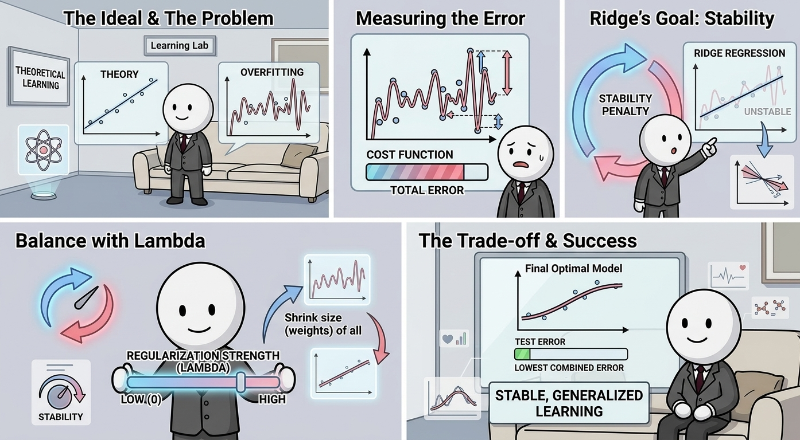
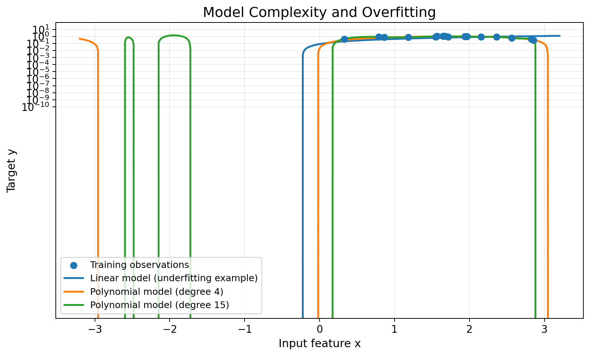
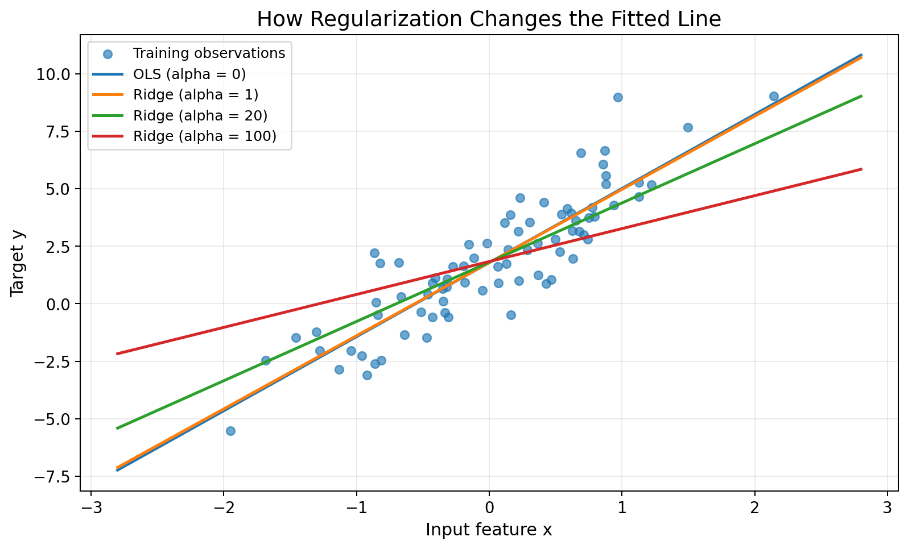
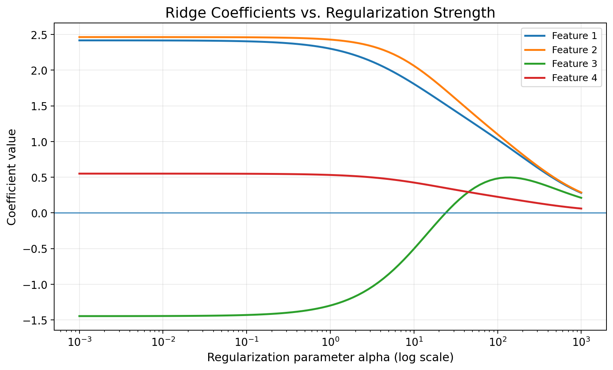
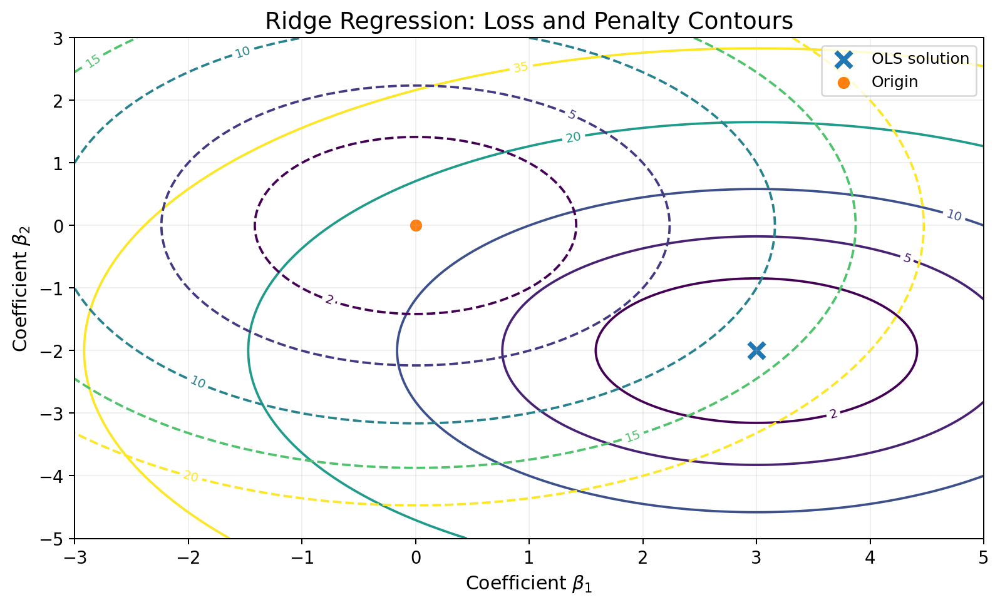
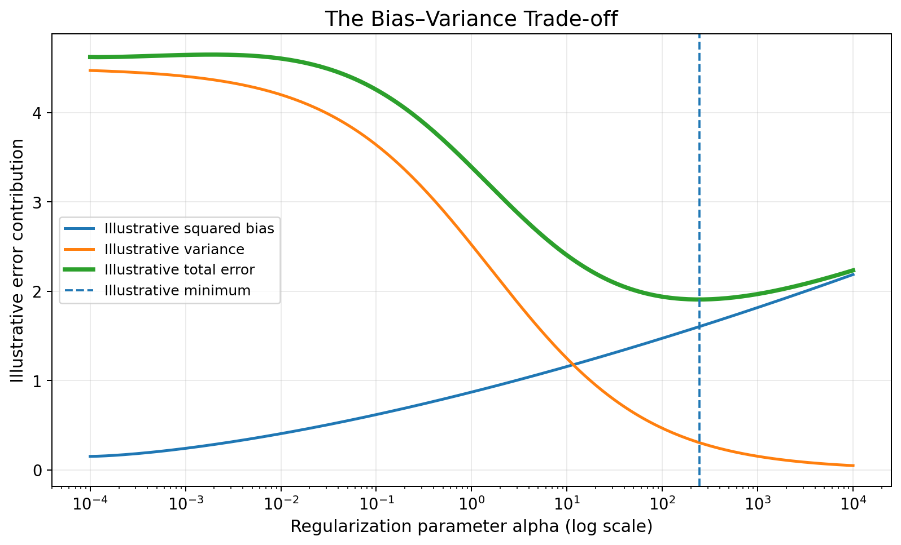

<!-- _footer: "" -->
<!-- _paginate: "" -->



---

<!-- _class: cover_e -->
<!-- _header:   --> 
<!-- _footer:  --> 
<!-- _paginate: "" -->

# Ridge Regression (L2)

#### Understanding Linear Models with L2 Regularization

Introduction to Machine Learning
Zhang Li, Jing Ming
Fall 2026

---

<!-- _header: Learning objectives -->
<!-- _class: toc_b -->
<!-- _footer: "" -->
<!-- _paginate: "" -->

* Understand ordinary linear regression.
* Explain why overfitting occurs.
* Derive the Ridge Regression objective.
* Understand the role of the regularization parameter.
* Interpret Ridge Regression results.

---

### What Is Linear Regression?

Linear regression predicts a continuous target using a linear combination of input features.

For one feature: $\hat y = \beta_0+\beta_1x$

For multiple features: $\hat y=\beta_0+\beta_1x_1+\cdots+\beta_px_p$

Where:

* $y$: observed target.
* $\hat y$: predicted target.
* $x_j$: input feature.
* $\beta_j$: coefficient associated with feature $j$.
* $\beta_0$: intercept.

Goal: Find coefficients that make predictions close to the observed values.

---

### How Does Linear Regression Learn?

Suppose we have training observations:

$$
\mathcal D={(x_i,y_i)}_{i=1}^{n}
$$

For each observation, calculate the prediction:

$$
\hat y_i=\beta_0+\sum_{j=1}^{p}\beta_jx_{ij}
$$

The prediction error, or residual, is:

$$
e_i=y_i-\hat y_i
$$

Ordinary Least Squares (OLS) chooses coefficients to minimize the sum of squared residuals:

$$
\boxed{
\min_{\beta_0,\boldsymbol\beta}
\sum_{i=1}^{n}(y_i-\hat y_i)^2
}
$$

Large errors receive a larger penalty because the residuals are squared.

---

<!-- _footer: "" -->



---

### The Problem: Overfitting

A model can fit the training data well but perform poorly on unseen data.

This is called overfitting.

Common causes include:

* Too many correlated features.
* Too many features relative to the number of observations.
* Noisy training data.
* An unnecessarily complex model.

A model with very large coefficients may react strongly to small changes in the input.

Key idea: Good training performance does not guarantee good generalization.

---

<!-- _footer: "" -->



---

### The Idea Behind Ridge Regression

Ridge Regression modifies ordinary linear regression by penalizing large coefficients.

It balances two objectives:

 1. Fit the observed data well.
 2. Keep the coefficients relatively small.

The objective becomes:

$$
\boxed{
\min_{\beta_0,\boldsymbol\beta}
\left[
\sum_{i=1}^{n}(y_i-\hat y_i)^2
+
\lambda\sum_{j=1}^{p}\beta_j^2
\right]
}
$$

The first term measures prediction error.

The second term penalizes large coefficients.

This penalty is called L2 regularization.

---

### What Does the Regularization Parameter Do?

The parameter $\lambda$ controls the strength of regularization.

$$
J(\boldsymbol\beta)

\underbrace{\sum_{i=1}^{n}(y_i-\hat y_i)^2}{\text{Data fit}}
+
\underbrace{\lambda\sum{j=1}^{p}\beta_j^2}_{\text{Coefficient penalty}}
$$

|$\lambda$	|Effect|
|---|---|
$0$	|Equivalent to ordinary least squares
Small	|Mild coefficient shrinkage
Moderate	|Stronger coefficient shrinkage
Very large	|Coefficients approach zero

The intercept is typically not penalized.

Important: Ridge Regression shrinks coefficients toward zero but generally does not set them exactly to zero.

---

<!-- _footer: "" -->



---

<!-- _footer: "" -->

### How Does Ridge Change the Coefficients?

For centered data, the Ridge solution can be written as:

$$
\boxed{
\hat{\boldsymbol\beta}_{\text{ridge}}

(X^\top X+\lambda I)^{-1}X^\top y
}
$$

Here:

* $X$: feature matrix.
* $y$: target vector.
* $I$: identity matrix.
* $\lambda$: regularization strength.

When $\lambda=0$, this reduces to the ordinary least-squares solution when the inverse exists.

When $\lambda>0$, the added diagonal term stabilizes the solution.

For centered data with standardized, orthogonal features, each coefficient is shrunk according to:

$$
\hat\beta_j^{\text{ridge}}

\frac{\hat\beta_j^{\text{OLS}}}
{1+\lambda}
$$

This last expression assumes unit-scaled orthogonal features and the matching sum-of-squares objective.

---

### A Simple Numerical Example

Consider the model:

$$
\hat y=\beta_0+\beta_1x_1+\beta_2x_2
$$

Suppose ordinary least squares produces:

$$
\hat{\boldsymbol\beta}_{\text{OLS}}

\begin{bmatrix}
8.0\
-6.0
\end{bmatrix}
$$

The coefficients have relatively large magnitudes.

For an illustrative orthogonal, standardized design, Ridge with $\lambda=3$ gives:

$$
\hat{\boldsymbol\beta}_{\text{ridge}}

\frac{1}{1+3}
\begin{bmatrix}
8.0\
-6.0
\end{bmatrix}

\begin{bmatrix}
2.0\
-1.5
\end{bmatrix}
$$

The coefficients are smaller, so the model is less sensitive to changes in the corresponding features.

This example illustrates coefficient shrinkage, not a universal formula for arbitrary datasets.

---

<!-- _footer: "" -->



---

### Visualizing the Ridge Penalty

For two coefficients, the L2 penalty is:

$$
\beta_1^2+\beta_2^2
$$

Contours of this penalty are circles centered at the origin.

The data-fit objective has its own contours.

Ridge Regression finds a solution that balances data fit and the coefficient penalty.

As $\lambda$ increases, the solution is encouraged to move closer to the origin.

This geometric view helps explain why Ridge Regression can stabilize estimates when predictors are correlated.

---

<!-- _footer: "" -->

### Why Does Ridge Help with Correlated Features?

Suppose two features contain similar information.

Ordinary least squares may assign unstable coefficients to them:

$$
\beta_1\approx 12,\qquad \beta_2\approx -11
$$

Small changes in the training data may cause these coefficients to change substantially.

Ridge penalizes large coefficients and tends to produce more stable estimates.

Benefits:

* Reduces coefficient variance.
* Helps with multicollinearity.
* Can improve test-set performance.
* Works when the number of features exceeds the number of observations.

Trade-off:

Introducing regularization creates some bias in exchange for potentially lower variance.

---


<!-- _footer: "" -->



---

### The Bias–Variance Trade-off

As $\lambda$ increases:

* Coefficients generally shrink.
* Model flexibility decreases.
* Variance often decreases.
* Bias often increases.

If $\lambda$ is too small, overfitting may remain.

If $\lambda$ is too large, the model may underfit.

The best value depends on the dataset.

The objective is not to minimize training error alone. It is to achieve good performance on unseen data.

---

<!-- _footer: "" -->

### Choosing Lambda with Cross-Validation

A common approach is to evaluate several candidate values of $\lambda$ using cross-validation.

Example grid:

$$
\lambda\in
{10^{-4},10^{-3},10^{-2},\ldots,10^4}
$$

Procedure:

1. Split the training data into cross-validation folds.
2. Fit Ridge Regression using each candidate $\lambda$.
3. Evaluate validation error.
4. Select the value with the lowest average validation error.
5. Refit the model on all training data.
6. Evaluate once on a separate test set.

Use a pipeline to standardize features separately within each training fold.

This avoids information leakage from the validation folds.

---

### Ridge Regression in Python

Scikit-learn provides Ridge Regression through Ridge and RidgeCV.

```python
from sklearn.pipeline import make_pipeline
from sklearn.preprocessing import StandardScaler
from sklearn.linear_model import RidgeCV
import numpy as np
alphas = np.logspace(-4, 4, 50)
model = make_pipeline(
    StandardScaler(),
    RidgeCV(alphas=alphas)
)
model.fit(X_train, y_train)
ridge = model.named_steps["ridgecv"]
print("Best alpha:", ridge.alpha_)
print("Coefficients:", ridge.coef_)
y_pred = model.predict(X_test)
```

---

Notes:

* X_train and y_train are the training data.
* X_test is held-out test data.
* RidgeCV selects the regularization parameter using cross-validation by default.
* StandardScaler prevents features with large numeric scales from dominating the penalty.
* The intercept is not penalized by default.

---

### Ridge vs. Other Linear Models

|Property	|Linear Regression	|Ridge	|Lasso
|---|---|---|---|
Objective	|Squared error	|Squared error + L2	|Squared error + L1
Shrinks coefficients	|No explicit penalty|	Yes	|Yes
Can set coefficients exactly to zero|	Not generally	|Not generally	|Yes
Handles correlated features	|Can be unstable	|Often effective	|May select one feature
Feature selection	|No built-in sparsity	|No built-in sparsity	|Often produces sparse models

> Ridge is especially useful when many features contribute to the target and coefficient stability matters.
> Lasso may be more suitable when a sparse model is desired.

---

### Key Takeaways

Ridge Regression = Linear Regression + L2 Regularization

Remember these five points:

1. Ordinary linear regression minimizes squared prediction errors.
2. Ridge adds a penalty for large coefficients.
3. The regularization parameter $\lambda$ controls shrinkage.
4. Ridge is particularly useful for correlated features and unstable estimates.
5. Cross-validation helps select a suitable regularization strength.

Final lesson: A slightly less flexible model can generalize better to unseen data.

---

### The Most Important Concept to Remember

Ridge Regression solves the following optimization problem:
$$
\boxed{
\hat{\boldsymbol\beta}
=
\arg\min_{\boldsymbol\beta}
\left[
\sum_{i=1}^{n}(y_i-\beta_0-\mathbf{x}_i^\top\boldsymbol\beta)^2
+
\lambda\|\boldsymbol\beta\|_2^2
\right]
}
$$
In plain language:

* Linear Regression asks: How can I minimize prediction errors?
* Ridge Regression asks: How can I minimize prediction errors while avoiding unnecessarily large coefficients?

---

The regularization parameter controls the balance.

One final implementation detail: in scikit-learn, the parameter is named alpha, whereas the mathematical slides use \lambda. They play the same role in the standard Ridge objective.

Also, the exact numerical value of alpha depends on the scaling of the features and the formulation of the loss function. Standardizing the predictors and selecting alpha through cross-validation is a good general starting point.